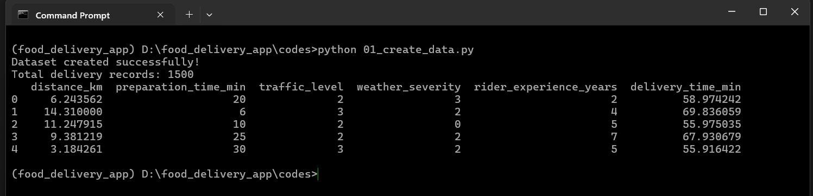
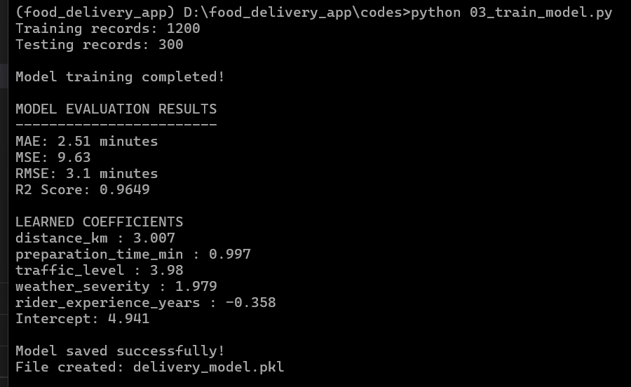
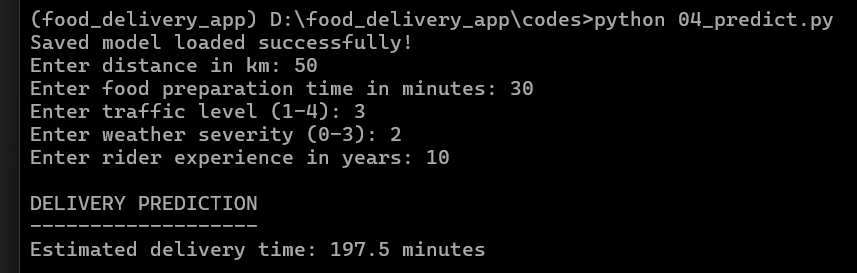
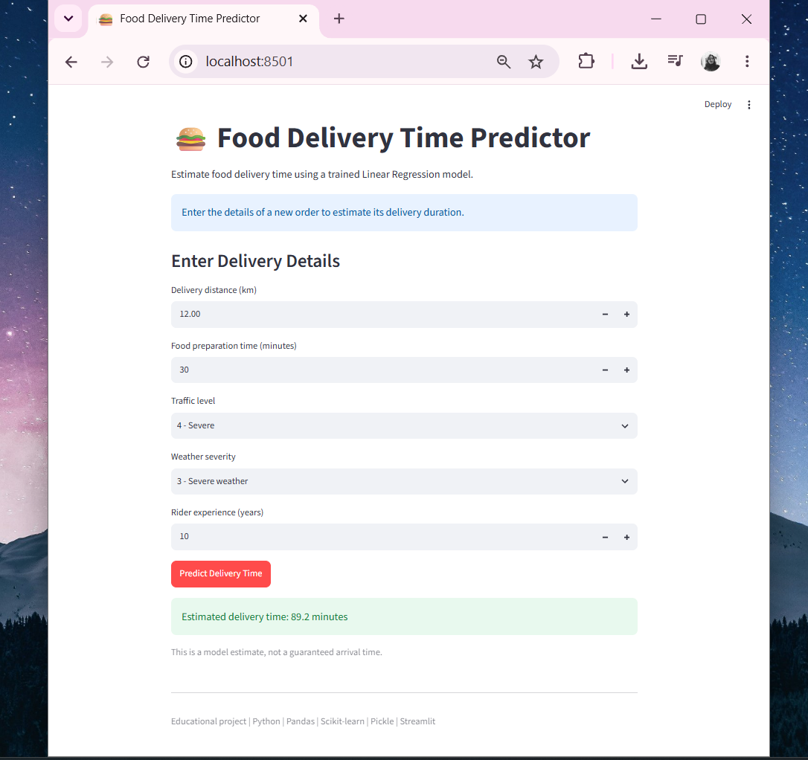

## This file contains the outputs we got after running our project at each step.

- python 01_create_data.py
  

- [02_explore_data.ipynb](02_explore_data.ipynb) contains the output of our [02_explore_data.py](02_explore_data.py) itself in jupyter notebook .ipynb file.

- python 03_train_model.py
  

- python 04_predict.py
  

- streamlit run 05_app.py
  
